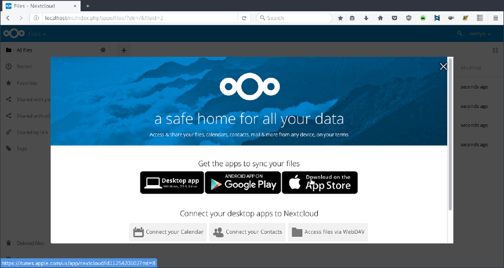

### System Requirements

To run Nextcloud Server, it's recommended to meet the following requirements:

- 512MB RAM
- Linux Server (Recommended Debian 7, SUSE Linux Enterprise Server 11 SP3 &
  12, Red Hat Enterprise Linux/CentOS 6.5 and 7, Ubuntu 14.04 LTS, 16.04 LTS)
- Web server: [Apache 2 (mod_php, php-fpm)][1] or [Nginx (php-fpm)][2]
- PHP >= 5.6
- Databases: MySQL/MariaDB 5.5+; PostgreSQL; Oracle 11g

<!--more-->

### Database Requirements for MySQL / MariaDB

To run Nextcloud server with MySQL/MariaDB, the following additional settings
are required:

- Disable _Binary Logging_ or set the log format to "mixed"
  (BINLOG_FORMAT = MIXED).
- InnoDB storage engine
- “READ COMMITTED” transaction isolation level.

### Emoji (UTF8 4-byte) support with MySQL / MariaDB

To enable emoji support in Nextcloud, the database must use the `utf8mb4`
_charset_ and `utf8mb4_general_ci` _collate_, for example:

```
CREATE DATABASE nextcloud CHARACTER SET utf8mb4 COLLATE utf8mb4_general_ci;
```

### PHP Prerequisites

The following modules are required to run Nextcloud:

- PHP (>= 5.6, 7.0 or 7.1)
- PHP module ctype
- PHP module dom
- PHP module GD
- PHP module iconv
- PHP module JSON
- PHP module libxml (Linux package libxml2 must be >=2.7.0)
- PHP module mb multibyte
- PHP module posix
- PHP module SimpleXML
- PHP module XMLWriter
- PHP module zip
- PHP module zlib

For database connections

- PHP module sqlite
- PHP module pdo_mysql (MySQL/MariaDB)
- PHP module pgsql (requires PostgreSQL >= 9.0)

### Preparing the Server

Download the Nextcloud archive from <https://nextcloud.com/install>, then
extract it to the web server's root folder.

```
$ tar xjvf nextcloud-11.0.2.tar.bz2
```

Or, if you're using the .zip file

```
$ unzip nextcloud-11.0.2.zip
```

Change file ownership

```
# chown www-data:www-data -R nextcloud
```

Enable `mod_rewrite`, `mod_headers`, `mod_env`, `mod_dir`, and `mod_mime`.

```
# a2enmod rewrite
# a2enmod headers
# a2enmod env
# a2enmod dir
# a2enmod mime
```

Restart the Server

```
# systemctl restart apache2.service
```

Or

```
# systemctl restart nginx.service
```

### Preparing the Database

Log in to the database server — I'm using MariaDB here — then create a new
database

```
CREATE DATABASE nextcloud CHARACTER SET utf8mb4 COLLATE utf8mb4_general_ci;
```

Create a new user specifically for Nextcloud (optional)

```
CREATE USER 'nextcloud'@'localhost' IDENTIFIED BY 'password';
GRANT ALL PRIVILEGES ON nextcloud.* TO 'nextcloud'@'localhost' IDENTIFIED BY 'password';
```

### Install Nextcloud

Access Nextcloud at <http://localhost/nextcloud>. In the database section,
select MySQL/MariaDB and fill in the details you created earlier. Once done,
Nextcloud is ready to use. See the
[Nextcloud documentation](https://docs.nextcloud.com) for more information.


