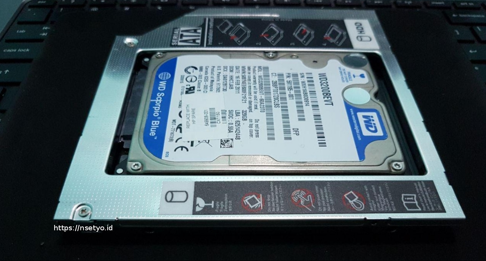
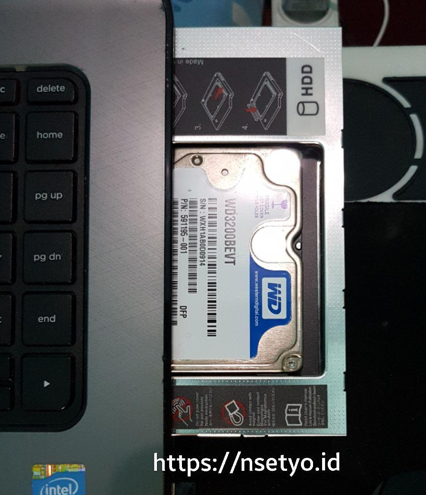
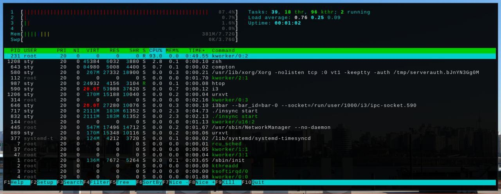
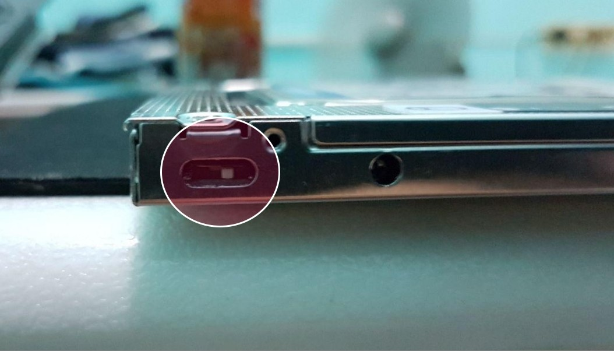

A while ago I decided to replace the HDD in my laptop with an SSD. SSDs are
much faster than regular HDDs, but they cost more. I bought a 120GB SanDisk SSD
for Rp 560,000 — at the same store, a 500GB HDD was selling for Rp 590,000.

Because the SSD's capacity is smaller, I decided to keep using the HDD as
secondary storage with an HDD caddy. The caddy replaces the DVD-ROM drive in
the laptop, which I never use.

<!--more-->

### The CPU Usage Problem

After the installation, something odd showed up in my laptop's CPU usage graph.
Even when _idle_, with no applications open, CPU usage was quite high, as you
can see in the image below:

At first I thought the problem was because I was using GNU/Linux. But when I
entered the BIOS menu, CPU usage was still high — I could tell from the cooling
fan humming louder than normal. As it turned out, the fix was simply to slide
the _switch_ on the HDD caddy, as shown in the image below:

---

**Notes**

1. I bought the HDD caddy at
   [Jakmall](https://www.jakmall.com/search?q=9704838345891)
2. Source:
   [http://forum.notebookreview.com][http://forum.notebookreview.com/threads/hp-elitebook-8560p-wont-shutdown.655065/page-2#post8986739]
