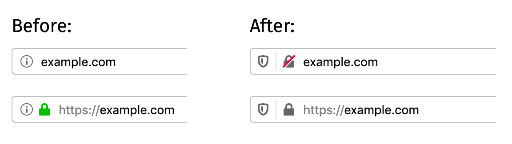
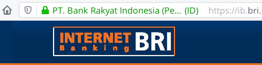

After writing my previous article about HTTPS, I noticed that Mozilla Firefox
now shows a grey padlock icon for HTTPS pages instead of a green one.[^1]

<!--more-->

I personally prefer HTTPS to be shown with a green padlock icon, so to bring
it back I changed the `about:config` setting
`security.secure_connection_icon_color_gray`. Set its value to `false`, then
restart the browser.

As a bonus, you can also make Firefox show EV (_Extended Validation_)
certificate information by setting
`security.identityblock.show_extended_validation` to `true`.

[^1]:
    https://blog.mozilla.org/security/2019/10/15/improved-security-and-privacy-indicators-in-firefox-70/
